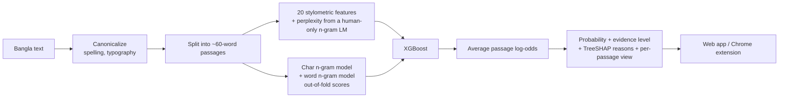

# Prohori (প্রহরী): a Bangla AI-text detector that shows its reasons and its error rates

> Paste Bangla text (or right-click a selection in Chrome) and get a **probability, the measured reasons behind it, and an honest statement of how much to trust it**. It abstains when it should, and it never says "AI-written" as a verdict.

**Live app:** https://prohori-mhuf.onrender.com (free tier: the first request after a quiet period can take up to a minute)
**Chrome extension:** [`extension/`](extension/) (load unpacked in 2 minutes, see [extension/README.md](extension/README.md))

<!-- Add screenshots after you take them, then uncomment:


-->

---

## Why this project exists

AI-writing detectors cause real harm when they are wrong: a student is accused of cheating because their writing is "too clean". Most general-purpose detectors are built and evaluated for English, and Bangla has far less data and tooling. I did not benchmark any commercial detector here, so I make no comparison claims. The goal of Prohori was narrower and more honest:

1. work for **Bangla** specifically,
2. **explain** every score in terms a teacher can check,
3. **measure and publish its own failure modes**, including the one that nearly sank the first version.

No LLM is called when you press Analyze. Scoring is classical, fast (15–200 ms), private and reproducible, and runs in about 270 MB of RAM.

## Results (measured, not claimed)

Evaluated with 5-fold cross-validation on 1,585 texts (800 human/AI pairs of modern Bangla), where **a human text and its AI rewrite never land on opposite sides of a split**.

| Measure | Result |
|---|---|
| Overall accuracy / ROC-AUC | **76.5%** / 0.85 |
| Real human text wrongly flagged (at the app's 80% threshold) | **4.1%** |
| When the app is ≥80% confident | right **88.4%** of the time, answers on 52% of ~60-word texts |
| Accuracy by text length | 72% (<40 words) · 71% (40–60) · 83% (60–90) · **87% (90+)** |
| Long documents scored passage by passage (*synthetic* test, optimistic) | 90–99% |

**Where it is weak (also shown inside the app):**

| Stress test | Result |
|---|---|
| An AI model it has never seen (leave-one-generator-out) | ChatGPT caught 63% (83% when seen), DeepSeek 28% (52%), Claude 85%, Gemini 79% |
| A kind of human text it has never seen (leave-one-domain-out) | accuracy **57–62%**, and up to 32% of unseen-domain human news flagged |

That last row is the honest headline: with two human domains in the training data the model does **not** generalize across domains. The data plan to fix it is in [DATA_GUIDE.md](DATA_GUIDE.md).

## The most interesting thing I found: the model learned "polished = AI"

My improved model scored 80.8%. Then I tested it properly, on a held-out split. I took human texts and changed **only spelling variants and typography** (কোন→কোনো, উপর→ওপর, straight quotes→curly, hyphen→em dash), with no change in meaning:

| Edit | Before the fix |
|---|---|
| Polish human text | human texts flagged as AI rose from **7.6% to 18.5%** (at 0.8), and 18.5% to 36.3% (at 0.5) |
| Roughen AI text | AI texts caught fell from 77.5% to 55.0% (at 0.5) |

The dataset's human texts (old textbooks and news) and its AI rewrites differ in spelling convention, so the model had learned a **polish detector**: em dashes were 18× more common in the AI texts and semicolons 9×, plus formal words like "এই / সেই / তাঁর / অত্যন্ত" versus colloquial "উপর / সাথে / এটা". A careful human writer would be flagged.

**Fix:** a canonicalization layer ([`prohori/canon.py`](prohori/canon.py)) collapses spelling variants, typography and meaning-identical formal/colloquial pairs *before any feature is computed*. Scores are now provably invariant to those edits (unit-tested), at a measured cost of about 4 points of accuracy. I consider that the correct trade: most of those 4 points were the shortcut.

## How it works



* **Features:** sentence rhythm, vocabulary variety, function-word share, punctuation habits, word length, repetition (Yule's K), connector use, and perplexity under a Laplace-smoothed trigram model trained on human text only.
* **Surface models:** character and word n-gram logistic regressions, fed to XGBoost as features so the explanation stays SHAP-based and can name the actual patterns that drove the score.
* **Explanations:** exact TreeSHAP values computed natively by XGBoost (verified identical to the `shap` library), shown as plain-language reasons with the human/AI reference medians.
* **Passage scoring:** training texts average ~60 words, so long texts are cut into ~60-word passages and the log-odds averaged. This removes the length drift of scoring a whole essay at once, and gives a per-paragraph view.
* **Abstention and evidence levels:** under 50 words nothing is flagged; between 20% and 80% the answer is "inconclusive"; the app states how much text the score rests on.

### Engineering decisions worth noting

| Problem | What I did |
|---|---|
| Human/AI twins leaking across train and test | Split by `Pair_ID`, not by row |
| Perplexity feature scored on the texts its own LM was trained on | Cross-fitted: every training row is scored by a model that never saw it or its twin |
| A confounded sub-corpus (WikiSource's archaic spelling = "human") | Excluded, and reported (on the same split, an inflated 86.6% became an honest 75.7%) |
| "Polish = AI" | Canonicalization layer, plus a counterfactual stress test |
| Whole-essay scoring drifts out of the training length | Passage-wise scoring |
| Heavy dependencies (`bnlp`, `shap`, `numba`) too big for a free tier | Replaced with a lightweight tokenizer (token-identical on all 3,987 texts) and native TreeSHAP |
| Overstated confidence | Selective-accuracy table, unseen-generator and unseen-domain tests, all published in-app |

## Limitations and ethics (read before using it on a person)

* **A probability, not proof.** About 1 in 25 genuine human texts is still flagged, and at 50% confidence about 1 in 5. Use a flag to start a conversation, never to accuse.
* **Short text is unreliable** (under 100 words), and **unseen AI models and unseen domains are caught much less often** (see the stress tests).
* **Trained on one dataset** (textbook and news text, rewritten by four LLMs). It has not been validated on real student essays; that validation is the first thing to do before any institutional use.
* **Adversarial users** can paraphrase or edit AI text to evade it. No detector is robust to a determined evader.
* **Privacy:** the text you check is sent to the server for scoring and is not stored by the app. For sensitive text, run your own instance.
* Authorship questions deserve human judgment and due process; this tool is evidence for a conversation, nothing more.

## Run it

```bash
python -m venv venv && venv\Scripts\activate        # Windows (use source venv/bin/activate on Linux/macOS)
pip install -r requirements-dev.txt
python -m pytest -q                                   # 12 tests
uvicorn api.main:app --reload                         # http://localhost:8000
```

Retrain and re-measure (needs the dataset in `data/raw/`, see below):

```bash
python scripts/prepare_dataset.py
python scripts/train.py --exclude-sources wikisource --refit-all
python scripts/evaluate_cv.py --exclude-sources wikisource     # writes models/cv_report.json shown in the app
python scripts/eval_external.py --file <any labeled Bangla dataset>   # test on data it has never seen
```

Deploy: the repo contains a `Dockerfile` and `render.yaml` (see [DEPLOY.md](DEPLOY.md)). Windows machines that block compiled Python files can use [WINDOWS_VSCODE.md](WINDOWS_VSCODE.md) or run training on Google Colab.

## Chrome extension

Select Bangla text on any page, right-click **Check selection with Prohori** (or press **Alt+Shift+P**), and a result card appears on the page with the score, reasons and per-passage view. No account, no always-on page access: it only reads a page when you ask. Details and Web Store notes: [extension/README.md](extension/README.md).

## Repository map

```
prohori/            canon.py · features.py · surface.py · model.py · bntok.py   (the library)
api/main.py         FastAPI: /analyze · /health · /model-info
frontend/           the web app (single HTML file, no build step)
extension/          Chrome extension (Manifest V3), with offline tests
scripts/            prepare_dataset · train · evaluate_cv · eval_external · add_dataset · import_corpus · generate_ai_rewrites · finetune_banglabert
models/             trained artifacts + cv_report.json (the numbers above)
tests/              pytest suite
```

## Roadmap

1. More human domains and more AI generators (see [DATA_GUIDE.md](DATA_GUIDE.md)); target: unseen-domain accuracy of at least 75% with under 5% of human text flagged.
2. Validate on real, consented student essays.
3. Fine-tune a Bangla transformer (script included, not yet run) and blend it in only if it clearly beats the classical numbers on the same held-out data.
4. Local calibration for an institution's own writing.

## Data and credits

* Training data: *A Benchmark Dataset for Human Vs. AI-Rewritten Bengali Text Detection*, Mendeley Data, DOI [10.17632/9gffsw9mjy.3](https://doi.org/10.17632/9gffsw9mjy.3) (human texts from NCTB textbooks, Wikisource and pre-2020 news; each rewritten by ChatGPT, Claude, Gemini or DeepSeek). Please check the dataset page for its licence and cite its authors.
* Built with Python, scikit-learn, XGBoost, NLTK, FastAPI.

## Author

Built by **Rakibul Islam**, Statistics undergraduate at SUST, Sylhet. [github.com/rakib120207](https://github.com/rakib120207)
